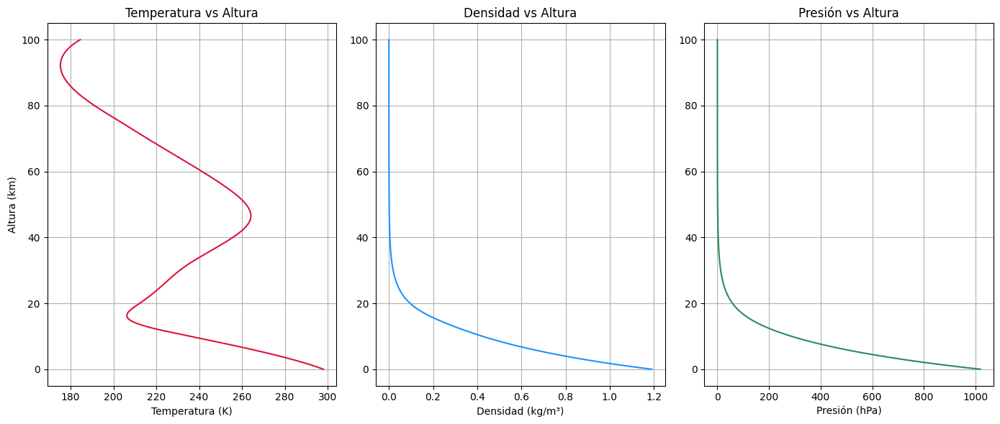
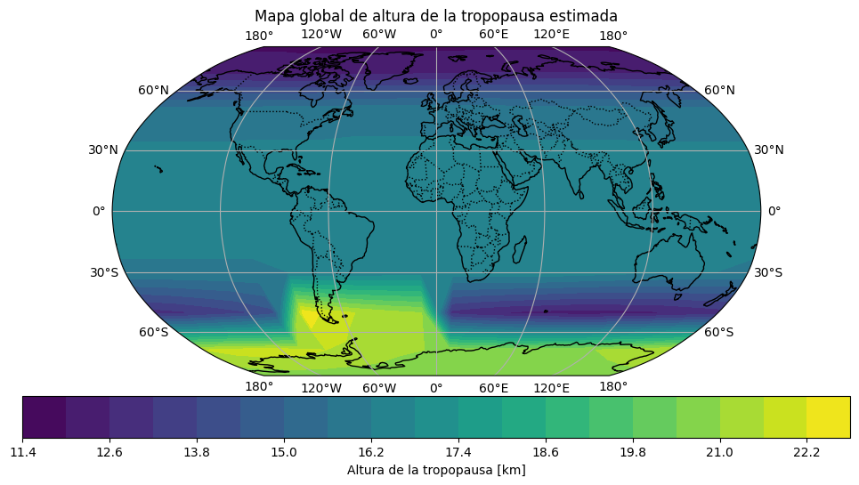
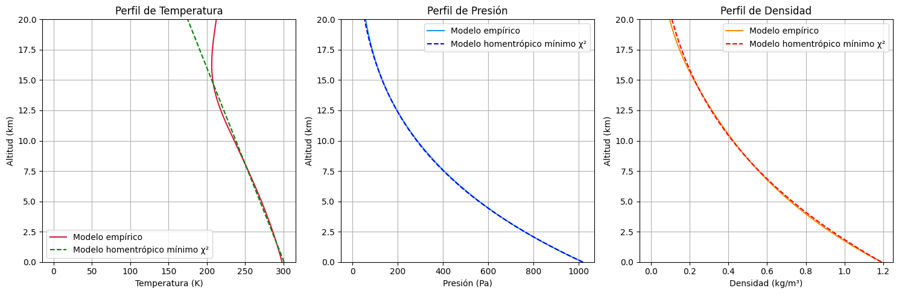

# Earth Atmosphere Modeling with NRLMSISE-00

**Computational course project · Medios Continuos · Universidad de Antioquia · 2025**  
**Author:** Manuela Marín Gómez  
**Code:** Python / Jupyter Notebook  
**Status:** Coursework portfolio — results and implementation pending additional verification.

## Overview

This repository presents the atmospheric-modeling component of an undergraduate computational workshop. It uses the **NRLMSISE-00 empirical model of Earth's atmosphere** to obtain and explore vertical atmospheric profiles and relate them to simplified physical descriptions of the atmosphere. Although the repository URL uses *planetary-atmosphere-modeling*, **the actual code investigates Earth's atmosphere; it does not model exoplanet atmospheres or habitability.**

The original workshop also included separate problems on gas escape and stellar polytropes. Only the **atmospheric component (Exercise 3)** is included here to keep this repository focused.

## Methods implemented in the notebook

- Request temperature and mass-density profiles from NRLMSISE-00 over 0–100 km altitude.
- Estimate pressure using an ideal-gas approximation and visualize pressure, density, and temperature profiles.
- Compare the numerically estimated pressure gradient to the hydrostatic-balance relation.
- Locate a candidate tropopause from changes in the vertical temperature gradient.
- Generate global tropopause-height maps and a visualization of surface-temperature variations during a day.
- Fit a simplified tropospheric temperature-gradient model using numerical minimization and explore global parameter maps.

## Short theoretical background

**Hydrostatic equilibrium.** A static atmospheric column is approximately governed by

$$
\frac{dP}{dz}=-\rho(z)g(z),\qquad
 g(z)=\frac{GM_\oplus}{(R_\oplus+z)^2},
$$

where $P$ is pressure, $\rho$ is mass density, $z$ is altitude, and $g$ is local gravitational acceleration.

**Ideal-gas approximation.** In the notebook, pressure is estimated using a fixed mean molar mass $M_{\rm air}$:

$$
P(z)\approx\rho(z)\frac{R_{\rm gas}T(z)}{M_{\rm air}}.
$$

This is a simplifying approximation, especially at higher altitudes, where atmospheric composition changes.

**Simplified tropospheric fit.** A temperature profile is parameterized as

$$
T_{\rm model}(z)=T_0-Lz,\qquad h_0=\frac{T_0}{L},
$$

where $L$ is the fitted lapse-rate parameter. The notebook minimizes a sum of squared **relative residuals** across model temperature, pressure and density; it labels this objective $\chi^2$, but it is not a conventional measurement-error-weighted statistical chi-square.

For details in Spanish, see [docs/theory_es.md](docs/theory_es.md).

## Visual examples from the original workshop

The figures below are **saved images from the original course run**. They are illustrative only: the shared notebook changes the exercise's personal reference date to an example date for privacy, removes saved outputs, and has **not been re-executed** for that date. Re-run the notebook before comparing its numerical outputs to these archived figures.

### Atmospheric vertical profiles



### Global tropopause estimate



### Example simplified-profile fit



## Files

```text
planetary-atmosphere-modeling/
├── README.md
├── notebooks/
│   └── earth_atmosphere_nrlmsise00.ipynb
├── figures/
│   ├── atmospheric_profiles_original_run.png
│   ├── global_tropopause_original_run.png
│   └── profile_fit_original_run.png
├── docs/
│   └── theory_es.md
├── requirements.txt
└── REVIEW_NOTES.md
```

## Run

1. Create a Python environment and install packages from `requirements.txt`.
2. Open `notebooks/earth_atmosphere_nrlmsise00.ipynb` in Jupyter or Google Colab.
3. Run the notebook cells in order. Access to updated space-weather data and map coastlines may require internet access; the full global calculation can take some time.
4. Inspect the generated numerical results. Do not assume archived figures correspond to the notebook's example inputs.

The original course notebook included Colab `pip install` commands; these are retained in the extracted notebook, alongside the dependency list here.

## Scope and review status

This is a **student computational exercise**, not a validated climate-modeling package. See [REVIEW_NOTES.md](REVIEW_NOTES.md) for points to revisit (including dataset reuse, fitting assumptions, and global extrapolations). No independent re-execution or quantitative validation was performed for this upload.

## Attribution

The notebook is adapted from the author's original 2025 undergraduate workshop. The original notebook explicitly credits ChatGPT (OpenAI o3, 14 Jul 2025) for assistance with parts of the global parameter-mapping loops; that note is preserved in the source. NRLMSISE-00 and its Python wrappers are external projects; no claim is made to having developed the empirical atmospheric model itself.
